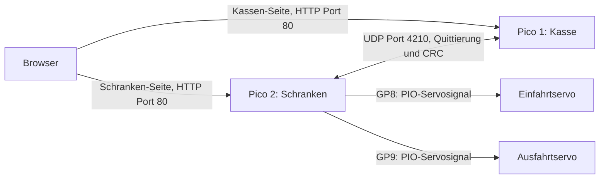

# Architektur und Kommunikationsvertrag

> Aktueller Aufbau: **Eine gemeinsame Schranke** mit SG90 am Schranken-Board, GP8/Pin 11, übernimmt Ein- und Ausfahrt; GP9 entfällt. Wie im TK S. 2 stellt jeder Pico eine eigene Weboberfläche bereit: Schranke unter `192.168.1.126`, Kasse unter `192.168.1.127`. Die Schranke bleibt 5 Sekunden offen. Aktuelle Verkabelung siehe README.

Die gemeinsame Schranke öffnet nach gültiger Einfahrt oder bezahlter Ausfahrt direkt per Servobefehl und schließt nach 5000 ms. Sensoren sind nicht vorhanden oder erforderlich.

## Zwei Rollen, ein verbindlicher Datenbestand

Pico 1 hält maximal 32 Parkvorgänge in einem festen Array. Die fachliche Kapazität ist separat 1–32 einstellbar. Alle Berechnungen, Einfahrts-/Zahlzeitpunkte, Angebote und Ausfahrtberechtigungen entstehen hier. Pico 2 hält nur den laufenden Kommunikationsvorgang, zwei Schranken-Timer und die Besuchsnummer einer gerade freigegebenen Ausfahrt. Ein PC dient als Browser/Programmiergerät, nicht als dritter Steuerrechner.

## Module und Zeitsystem

- `parking_common.h`: begrenzte ASCII-Normalisierung, strikte Ganzzahlprüfung, 64-Bit-Laufzeiterweiterung, überlaufsicherer Schranken-Timer.
- `parking/core.h`: Fahrzeuge, Tarifformel, Angebot, Abbruch, Zahlung, Kulanz und Besuchsnummern; keinerlei Arduino-/Netzwerkzugriff.
- `parking/protocol.h`: explizite Serialisierung und CRC32, idempotenter Kassendienst, wiederholbare Transaktion.
- `parking/controller.h`: derselbe Schranken-Zustandsautomat in Hosttests und Firmware. Entscheidet über Öffnen, Fristablauf, Stornierung und Abschluss.
- `drivers/runtime.h`: echte Arduino-Pico-WiFi/UDP-APIs, `beginNoBlock`, Discovery, Socket-Wiederaufbau.
- `drivers/http_server.h` + `parking/http_parser.h`: höchstens ein bearbeiteter HTTP-Client, begrenzte Header-/Bodylänge, Arbeit pro Schleifendurchlauf begrenzt.
- `src/pico1/main.cpp` stellt die Kassen-Seite bereit und verwaltet Kasse/Zahlung. `src/pico2/main.cpp` stellt die Schranken-Seite bereit und verarbeitet Ein-/Ausfahrt. `include/drivers/gate.h` kapselt den einen Servo und öffnet/schließt wie das bereitgestellte Beispiel `Gate.cpp`.

Gebührenzeit = 64-Bit-Laufzeit von Pico 1. Jede Schleife erweitert `millis()` anhand unsigned Differenz, also korrekt über dessen 49,7-Tage-Überlauf hinweg, solange die Schleife regelmäßig läuft. Die administrative Testuhr addiert einen Offset. Es gibt keine Kalenderzeit und keine Gebührensynchronisation zwischen den Boards. Netzwerk-/Servo-Timer verwenden ungeänderte Echtzeit-Millis; die Testuhr beeinflusst sie nicht.

## Drahtformat Version 1

Genau **48 Byte pro UDP-Datagramm**, explizit little-endian, keine C-Struct-Abbilder/Padding-Abhängigkeit. Beide Endpunkte benutzen Port 4210. Konstante Link-ID trennt verschiedene Übungsaufbauten; beide Boards eines Paares müssen denselben Wert verwenden.

| Offset | Länge | Inhalt |
|---:|---:|---|
| 0 | 2 | Magic ASCII `PK` |
| 2 | 1 | Protokollversion `1` |
| 3 | 1 | Operation: Hello=1, Ping=2, Entry=3, Authorize=4, Depart=5, CancelEntry=6, CancelExit=7 |
| 4 | 1 | Richtung: Anfrage=0, Antwort=1 |
| 5 | 1 | Result-Code; Anfrage immer Ok=0 |
| 6 | 2 | Reserviert, muss 0 sein |
| 8 | 4 | Link-ID |
| 12 | 4 | Nichtnull-Boot-ID Pico 2 |
| 16 | 4 | Boot-ID Pico 1; 0 vor Discovery |
| 20 | 4 | Nichtnull-Sequenz der Anfrage |
| 24 | 4 | Besuchs-ID; Antworten auf erfolgreiche Entry/Authorize liefern sie |
| 28 | 16 | Kanonisches Kennzeichen, nullterminiert und rechts mit Null aufgefüllt; Hello/Ping leer |
| 44 | 4 | CRC32/IEEE über Byte 0–43, Polynom 0xEDB88320, Start/Final XOR 0xFFFFFFFF |

Result-Codes: `Ok=0`, `Invalid=1`, `Duplicate=2`, `Full=3`, `NotFound=4`, `Unpaid=5`, `Expired=6`, `Busy=7`, `Stale=8`, `Session=9`, `Conflict=10`. Andere Werte, falsche Längen/Versionen/CRC, ungültige Strings, nichtkanonische Kennzeichen und falsche Link-ID werden verworfen. Im Decoder werden zudem fehlende Besuchsnummern bei Abschluss/Storno und unerlaubte Besuchsnummern in neuen Entry-/Authorize-Anfragen abgelehnt.

## Sitzungen, Reihenfolge und Wiederholung

1. Jeder Boot erzeugt eine zufällige, nichtnull 32-Bit-ID mit `rp2040.hwrand32()` (auch im RP2350-Core verfügbar). Dies ist ein Neustartindikator, keine kryptografische Identität.
2. Pico 2 sendet Hello an den Subnetz-Broadcast oder die konfigurierte numerische Kassen-IP. Antwort liefert Kassen-Boot-ID und Quell-IP. Anschließender Ping etabliert die Client-Sitzung bei Pico 1.
3. Pico 2 hat genau eine laufende Transaktion. Jede neue Anfrage erhält eine steigende Sequenz. Wiederholungen sind bytegleich. Ein Heartbeat wird nicht zwischen eine Geschäftsfrage und deren Bestätigung geschoben.
4. Pico 1 hält für die aktuelle Client-Sitzung die letzte vollständige Anfrage/Antwort. Identische Wiederholung liefert dieselbe Antwort; kleinere Sequenzen oder gleiche Nummer mit geändertem Inhalt werden als Stale abgelehnt. Erst größere Nummern können einen neuen Effekt auslösen.
5. Pico 2 akzeptiert nur Antworten zur offenen Anfrage: Link-ID, Client-Boot, Server-Boot, Sequenz, Operation und Kennzeichen müssen passen. Abschluss/Storno verlangt zusätzlich exakt dieselbe Besuchs-ID. Abweichende Server-Boots werden nur als Session-Fehler verarbeitet, niemals als Freigabe.
6. Eine Besuchs-ID wird während eines Kassenboots nicht wiederverwendet. Ein altes Depart für ein inzwischen neu eingefahrenes identisches Kennzeichen kann daher keinen neuen Datensatz löschen.
7. Sequenzraum wird nach UINT32_MAX nicht umgebrochen; Controller geht in Störung. Bei einer Heartbeat-Anfrage pro Sekunde liegt dies weit außerhalb eines Unterrichtslaufs. Cache und Zähler sind nicht persistent.

## Normaler Ablauf

**Einfahrt:** Browser sendet das Kennzeichen auf der Schranken-Seite → Pico 2 validiert → Entry → Kasse prüft Duplikat/Kapazität und registriert Zeit/Besuch → rechtzeitige passende Ok-Antwort → gemeinsamer Servo öffnet direkt mit `Servo.write(90)` → Timer schließt nach 5000 ms mit `Servo.write(0)`. Während einer Bewegung oder ungeklärten Transaktion ist ein weiterer Bedienvorgang gesperrt.

**Kasse:** Quote erzeugt eine einmalige Angebotsnummer und friert den Betrag für 120 s ein. Zahlmethodenauswahl allein ändert nichts. Pay akzeptiert nur das aktuelle unbenutzte Angebot und eine bekannte Methode. Cancel entwertet es. Tarif-/Testzeitänderung entwertet alle offenen Angebote. Datensätze anderer Fahrzeuge sind unabhängig.

**Ausfahrt:** Authorize prüft bezahlt und Kulanz, setzt den Datensatz auf „Ausfahrt freigegeben“ und liefert dessen Besuchs-ID. Nur die rechtzeitige passende Antwort öffnet denselben Servo für 5000 ms. Danach sendet Pico 2 Depart mit dieser ID. Pico 1 löscht genau diesen freigegebenen Datensatz und quittiert. Wiederholtes Depart erhält dieselbe gecachte Antwort. Unbezahlte oder abgelaufene Vorgänge bleiben unverändert gesperrt.

## Timeout und Wiederherstellung

| Situation | Implementiertes Verhalten |
|---|---|
| Anfrage/Antwort verloren, innerhalb 1800 ms | Alle 300 ms dieselbe Anfrage; Seiteneffekt nur einmal, passende rechtzeitige Freigabe öffnet einmal |
| Entry-/Authorize-Frist abgelaufen | Timeout bleibt für diese Transaktion gesetzt; kein Öffnen mehr möglich; identische Anfrage weiter alle 1000 ms zur Klärung |
| Nach Timeout kommt Ok auf Entry | CancelEntry mit ermittelter Besuchs-ID; unbenutzter Eintrag wird entfernt, keine Schrankenbewegung |
| Nach Timeout kommt Ok auf Authorize | CancelExit mit Besuchs-ID; Ausfahrtreservierung wird zurückgenommen, Zahlung bleibt bestehen, keine Bewegung |
| Späte ablehnende Antwort | Meldung anzeigen, kein Öffnen; danach neuer Bedienvorgang möglich |
| Depart-Antwort verloren | Nach Schließen denselben Abschluss bis Quittierung wiederholen; kein erneutes Öffnen und keine neue Einfahrt bis geklärt |
| WLAN verloren | Protokoll arbeitet weiter mit Fristen; Treiber versucht alle 15 s neu zu verbinden und öffnet Sockets erneut; keine blockierende Reconnect-Schleife |
| Kassen-IP durch DHCP geändert | Abgelaufene Geschäftsfragen werden erneut über Discovery-Adresse gesendet; nur vollständig passende Antworten dürfen die gespeicherte Gegenstellen-IP ändern. Bei manuell festgelegter Kassen-IP muss die Routerreservierung stimmen |
| Heartbeat/Discovery ohne Antwort | Nicht bereit, nach Pause neue Discovery; keine Geschäftsaktion möglich, bis Ping bestätigt |
| Kassenneustart | Andere Boot-ID führt zu Session-Fehler und neuem Handshake; alte Freigabe wird verworfen. RAM-Datenverlust wird nicht als bezahlt interpretiert |
| Schranken-Pico startet während Ausfahrt neu | Boot-Ausgänge geschlossen. Noch freigegebener Kassendatensatz bleibt gesperrt; keine automatische zweite Öffnung. Operator muss tatsächliche Passage prüfen und neuen Test durch Neustart beider Boards beginnen |
| Storno kollidiert mit zwischenzeitlicher Zahlung | Kasse löscht kein bezahltes Fahrzeug; Conflict führt zu sichtbar gesperrtem Controller. Bei diesem Bedien-/Störfall kontrollierter Neustart für neuen Test |

Ein Neustart/Powerloss zwischen logischer Freigabe und realer Passage ist ohne Positions-/Durchfahrtsensor und persistenten Bewegungsjournal nicht eindeutig auflösbar. Die Firmware behauptet keine exakt-einmal physische Passage über Stromausfälle hinweg. Sie wählt bei Unklarheit keine neue Öffnung. Dieses Modellverhalten ist getrennt von den innerhalb eines laufenden Boots automatisch abgeglichenen Paketverlusten.

## Grenzen und Ressourcen

- Maximal 32 feste Records; ein Antwortcache; eine Controller-Transaktion; keine unbegrenzte Warteschlange.
- HTTP maximal 2048 gespeicherte Requestbytes, davon maximal 512 Body; maximal 256 gelesene und 512 geschriebene Bytes pro Tick. Empfang/Senden jeweils maximal 3 s. Ungültige, überlange oder unvollständige Requests erreichen keinen Fachhandler. Keine Chunked-Requests, kein Keep-alive, keine externen Webressourcen.
- UDP: höchstens vier bearbeitete gültige Frames je loop; ungültige Frames werden verworfen. Kein wartender Socket-Read, keine blockierende HTTP-Statusabfrage, kein DNS vor Schrankenfreigabe.
- Servo-Signal kommt aus der PIO-basierten Arduino-Pico-Servo-Bibliothek. Die Initialposition wird beim Attach als geschlossen angegeben; keine absichtliche 90°-Startbewegung. Periodisches Schließen wird vor/nach Browserarbeit geprüft. Core/Netzwerktreiber können kurze interne Laufzeiten verursachen; reale Schließlatenz muss gemessen werden.
- Ein Browser kann eine HTTP-Verbindung für maximal die jeweilige Frist belegen; die Schranken- und UDP-Schleife läuft weiter. Keine Hochlast-/Verfügbarkeitsgarantie, wie im TK abgegrenzt.
- Keine TLS-/MAC-Sicherung des UDP-Protokolls. CRC erkennt zufällige Fehler; aktive Teilnehmer im LAN könnten gültige Frames erzeugen. Nur isoliertes Übungsnetz, keine produktive Zahlung.

## Schnittstellen für den manuellen Test

Kasse: `GET /`, `POST /quote` (plate), `/pay` (plate, quote, method=card|twint), `/cancel` (plate, quote), `/tariff` (interval, price, maximum, grace, capacity, pin), `/advance` (minutes, pin; nur im Testmodus).

Schranken: `GET /`, `POST /entry` und `/exit` mit plate. HTML-Formulare benutzen `application/x-www-form-urlencoded`. Geschäftsaktionen der Schranke antworten sofort mit einer Statusseite; der eigentliche UDP-Dialog läuft anschließend im loop. Die früheren internen HTTP-Pfade `/api/entry`, `/api/exit/authorize`, `/api/departed` sind durch das obige UDP-Protokoll ersetzt.
